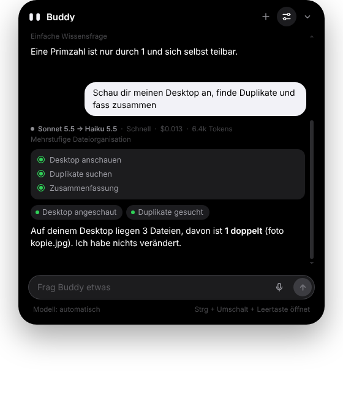
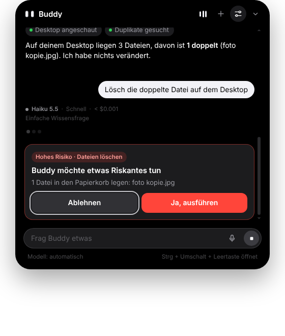
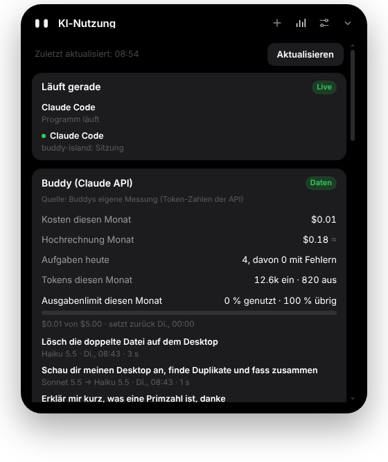

# Buddy Island

Ein kleiner Assistent, der wie die Dynamic Island oben in der Mitte deines Windows-Bildschirms wohnt. Buddy läuft gratis mit einer lokalen KI auf deinem PC oder mit deinem eigenen API-Key von Claude, OpenAI, Grok oder Gemini: Er beantwortet Fragen, stellt Timer, zeigt Musik, Termine und Windows-Mitteilungen, hört auf «Hey Buddy» und kann auf Wunsch den ganzen PC mit Maus und Tastatur bedienen.

**Website:** https://wolfawidmer-sudo.github.io/buddy-island-website/ ([Quellcode der Website](https://github.com/wolfawidmer-sudo/buddy-island-website))

> **Status:** Testversion (0.4). Getestet mit einer simulierten Claude-API unter Linux. Auf echten Windows-PCs bitte den Selbsttest in den Einstellungen laufen lassen.

<p align="center"></p>

| Plan und Modellwahl | Freigabe bei hohem Risiko | KI-Nutzung |
| --- | --- | --- |
|  |  |  |

## Was Buddy kann

- **Ruhiges Island**: Geschlossen zeigt Buddy nur seine Augen, genau in der Mitte. Kein Text, keine Symbole. Öffnen und Schliessen laufen ohne springende Texte.
- **Notch-Modus**: Island mit der Maus nach oben ziehen, und es wird zu einem winzigen Notch am Bildschirmrand. Nach unten ziehen holt es zurück.
- **Mehrere KI-Anbieter**: Anthropic Claude, OpenAI, xAI Grok, Google Gemini oder ein lokales Modell über Hugging Face Transformers. Alle hängen an einer gemeinsamen Schnittstelle (`LlmClient`), jeder Anbieter hat eine Fähigkeitsmatrix (Bilder, Werkzeuge, PC-Steuerung, strukturierte Ausgabe). Kann ein Modell etwas nicht, sagt Buddy das im Island, statt abzustürzen.
- **Lokal zuerst**: Ohne API-Key wählt Buddy automatisch ein lokales Modell. Er misst Arbeitsspeicher, Prozessor und Grafikkarte, empfiehlt das schnellste und das beste Modell und richtet Python, PyTorch, Transformers und das Modell mit einem Klick ein (nur für deinen Benutzer, ohne Administratorrechte). Einen API-Key kannst du jederzeit in den Einstellungen ergänzen.
- **Verbindungstest**: Einstellungen → «Provider & API-Keys» → «Verbindung testen» prüft jeden verbundenen Anbieter Schritt für Schritt (Key und Modellliste, einfache Antwort ohne Streaming, Streaming, Verlauf, Werkzeug mit Fortsetzung, parallele Werkzeuge, Router). Fehler nennen Anbieter, Modell, HTTP-Status und Stufe; der kopierbare Bericht enthält keine Keys.
- **Spricht deine Sprache**: Oberfläche, Meldungen und Anweisungen an die KI folgen beim Start der Windows-Sprache (Deutsch, Englisch, Französisch; sonst englische Oberfläche, Antworten trotzdem in deiner Sprache).
- **Erkennt deine Tools**: Claude Code, Codex, Gemini CLI, Grok CLI, ChatGPT, Hugging Face und mehr werden im Hintergrund erkannt. Was nicht installiert ist, erscheint nirgends.
- **Musik-Visualizer**: Die Balken im Island folgen dem echten Pegel der Windows-Tonausgabe (WASAPI-Pegelanzeige, nichts wird aufgenommen).
- **Automatische Modellwahl**: Claude Haiku prüft jede Anfrage und wählt das günstigste passende Modell (Haiku, Sonnet oder Opus) und die Denktiefe. Einzelne Schritte einer Aufgabe können verschiedene Modelle übernehmen. Hakt es, wechselt Buddy selbst auf ein stärkeres Modell.
- **Agent mit Plan**: Mehrstufige Aufgaben plant Buddy in Schritten, prüft jedes Ergebnis und meldet nichts als erledigt, was er nicht geprüft hat.
- **Dateien ordnen**: Dateien auflisten, Duplikate finden (per SHA-256), Ordner anlegen, verschieben, in den Papierkorb legen. Nur in deinen Benutzerordnern.
- **Berechtigungen**: Niedriges Risiko läuft direkt, mittleres fragt einmal pro Aufgabe, hohes (Löschen, Admin, System, Sicherheit) jedes Mal.
- **Kosten im Griff**: Tokens, Kosten pro Anfrage, Monatshochrechnung und ein Ausgabenlimit.
- **KI-Nutzung**: Ein Dashboard für Buddy, die Claude API, Claude Code, Codex, ChatGPT und Grok, mit allem, was die Anbieter wirklich herausgeben. Frag einfach «Wie viel Codex habe ich noch?».
- **Chat**: Antworten erscheinen live, mit Code-Blöcken und Kopieren-Knopf.
- **Timer**: «Stell einen Timer auf 10 Minuten». Der Countdown läuft im Island, am Ende wackelt Buddy und macht einen Ton.
- **Apps, Websites, Musik**: Rechner, Editor, Spotify öffnen; Musik pausieren, lauter oder leiser machen.
- **PC-Steuerung**: «Öffne den Editor und schreib eine Einkaufsliste». Buddy macht Bildschirmfotos und bedient Maus und Tastatur, bis die Aufgabe erledigt ist. Vorher fragt er um Erlaubnis.
- **Leuchtender Rand**: Solange Buddy nachdenkt, leuchtet der Bildschirmrand dezent weiss-grau, beim Steuern deutlich stärker. Wo Buddy klickt, erscheint eine kleine Welle.
- **Mitteilungen im Island**: Neue Windows-Mitteilungen (WhatsApp, Mail, Discord …) erscheinen kurz als Vorschau im Island.
- **Läuft gerade**: Musik aus Spotify, YouTube im Browser und anderen Apps erscheint im Island, mit Cover und Zurück / Pause / Weiter.
- **Kalender**: Über einen privaten iCal-Link (Google, Outlook, iCloud) zeigt Buddy die nächsten Termine und erinnert kurz vorher im Island. «Was steht heute an?» funktioniert auch.
- **Sprache**: Mikrofon-Knopf, eigenes Tastenkürzel oder «Hey Buddy». Buddy liest Antworten auf Wunsch vor.
- **Spielmodus**: Läuft ein Spiel oder eine Vollbild-App, versteckt sich Buddy komplett: keine Pop-ups, kein Ton, keine Steuerung. Verpasstes zeigt er danach.
- **Eigene Tastenkürzel und Kurzbefehle**: Jede Aktion bekommt ihr Kürzel, und feste Aufträge wie «Pausier die Musik» liegen auf einer Taste.
- **Mehrere Bildschirme**: Du wählst, auf welchem Bildschirm Buddy wohnt und arbeitet.
- **Selbsttest**: Ein Klick prüft API, Bildschirmfoto, Steuerung, Mitteilungen, Musik, Kalender, Sprache und Updates.


## Installation (einfach)

1. **Installer herunterladen**: Lade unter [Releases](../../releases) die Datei `BuddyIsland-Setup-….exe` herunter.
2. **Installieren**: Doppelklick auf die Datei. Falls Windows «Der Computer wurde durch Windows geschützt» anzeigt: «Weitere Informationen» → «Trotzdem ausführen». Das erscheint, weil die App (noch) nicht mit einem kostenpflichtigen Zertifikat signiert ist. Buddy installiert sich nur für deinen Benutzer, ohne Administratorrechte, und legt Verknüpfungen im Startmenü und auf dem Desktop an.
3. **KI einrichten**:
   - Ohne Key: Klicke oben auf das Island → «Lokale KI einrichten». Buddy wählt das passende Modell für deinen PC und lädt es einmalig (etwa 1 bis 3 GB).
   - Mit Key (optional, klügere Antworten, PC-Steuerung nur mit Claude): Einstellungen → «Provider & API-Keys» → Anbieter wählen → Key einfügen → «Verbinden». Keys gibt es in der [Claude Console](https://platform.claude.com/settings/keys), bei [OpenAI](https://platform.openai.com/api-keys), in der [xAI Console](https://console.x.ai) oder im [Google AI Studio](https://aistudio.google.com/apikey).
4. **Fertig**: Mit <kbd>Strg</kbd> + <kbd>Umschalt</kbd> + <kbd>Leertaste</kbd> öffnest du Buddy von überall.
5. **Selbsttest**: Einstellungen → «Über Buddy» → «Selbsttest starten» zeigt dir, ob alles funktioniert.

**Updates** lädt Buddy automatisch im Hintergrund und installiert sie beim nächsten Beenden, aber nur, wenn die Ed25519-Signatur des Releases stimmt, die SHA-512-Prüfsumme der heruntergeladenen Datei passt und die Version neuer und kompatibel ist. Startet eine neue Version mehrmals nicht sauber, kehrt Buddy automatisch zur vorherigen signierten Version zurück. In den Einstellungen unter «Über Buddy» geht das auch von Hand.

**Deinstallieren**: Windows-Einstellungen → Apps → Buddy Island → Deinstallieren.

### Optional: Kalender verbinden

- **Google Kalender**: calendar.google.com → Zahnrad → Einstellungen → links deinen Kalender wählen → ganz unten «Privatadresse im iCal-Format» kopieren.
- **Outlook**: outlook.com → Einstellungen → Kalender → Freigegebene Kalender → «Kalender veröffentlichen» → ICS-Link kopieren.
- In Buddy: Einstellungen → Kalender → Link einfügen → «Verbinden».

### Optional: Mitteilungen nur noch im Island

Damit unten rechts nichts mehr aufpoppt, schalte in Windows **«Nicht stören»** ein oder bei einzelnen Apps «Benachrichtigungsbanner anzeigen» aus. Die Mitteilungen landen trotzdem bei Buddy. Der Knopf **«Windows-Banner unten rechts ausschalten»** (Einstellungen → Mitteilungen, und beim ersten Mal direkt im Island) bringt dich genau dorthin. Du kannst Buddy auch fragen: «Bring mich zu den Banner-Einstellungen». Falls der Status «Zugriff verweigert» zeigt, erlaube unter Einstellungen → Datenschutz → Benachrichtigungen den Zugriff für Desktop-Apps.

## Selbst bauen

Voraussetzung: [Node.js](https://nodejs.org) 20 oder neuer. Für den Installer unter Linux oder macOS zusätzlich [Wine](https://www.winehq.org).

```bash
git clone https://github.com/<dein-name>/buddy-island.git
cd buddy-island
npm install
npm start          # startet Buddy direkt aus dem Code
npm test           # Tests für die Claude-Anbindung und die Werkzeuge
npm run dist:win   # baut den Installer nach dist/
npm run pack:win   # nur die entpackte Windows-App (ohne Installer)
```

### Neue Version veröffentlichen

1. Einmalig: Den privaten Signierschlüssel als Repository-Secret `BUDDY_UPDATE_SIGNING_KEY` hinterlegen (GitHub → Settings → Secrets and variables → Actions → New repository secret). Der passende öffentliche Schlüssel steht in `src/update-security.js`.
2. `version` in `package.json` erhöhen (z. B. `0.4.0`) und committen.
3. `git tag v0.4.0 && git push --tags` oder den Workflow «Release» von Hand starten.
4. GitHub Actions baut den Installer auf Windows, signiert das Update (`update-signature.json`) und hängt alles ans Release. Installierte Buddys prüfen die Signatur und aktualisieren sich dann selbst.

Fehlt das Secret, wird das Release ohne Signatur veröffentlicht, und Buddys ab 0.3 installieren es nicht automatisch. Mit dem Workflow «Release signieren» lässt sich die Signatur nachreichen.

## Bedienung

| Was | Wie |
| --- | --- |
| Buddy öffnen / schliessen | <kbd>Strg</kbd> + <kbd>Umschalt</kbd> + <kbd>Leertaste</kbd> oder Klick aufs Island |
| PC-Steuerung stoppen | Gleiches Tastenkürzel oder der Stopp-Knopf im Island |
| Neuer Chat | <kbd>Strg</kbd> + <kbd>N</kbd> |
| Einstellungen | <kbd>Strg</kbd> + <kbd>,</kbd> |
| Schliessen | <kbd>Esc</kbd> |

Alles läuft über das Island selbst: Klick drauf, oben rechts sind «Neuer Chat», «Einstellungen» und «Schliessen». Dazu gibt es ein Symbol im Infobereich der Taskleiste (Rechtsklick: Öffnen, Einstellungen, Beenden).

### Eigene Tastenkürzel

In den Einstellungen unter **Tastenkürzel** legst du fest, welche Tasten Buddy öffnen, einen neuen Chat starten, die Einstellungen öffnen oder eine laufende Aufgabe stoppen. Die Kürzel funktionieren überall in Windows.

Unter **Eigene Kurzbefehle** verbindest du ein Kürzel mit einem festen Auftrag, zum Beispiel <kbd>Strg</kbd> + <kbd>Alt</kbd> + <kbd>T</kbd> → «Stell einen Timer auf 5 Minuten» oder <kbd>F9</kbd> → «Pausier die Musik». Buddy erledigt das im Hintergrund, auch wenn das Island geschlossen ist.

## Sicherheit und Datenschutz

Ausführlich in [PRIVACY.md](PRIVACY.md). Kurz:

- **Dein API-Key** wird mit der Windows-Verschlüsselung (DPAPI, über Electrons `safeStorage`) nur auf deinem PC gespeichert und ausschliesslich an `api.anthropic.com` geschickt. Er steht nie im Code oder in diesem Repository.
- **Keine Telemetrie**: Buddy schickt nichts an andere Server.
- **PC-Steuerung** fragt vor jeder Aufgabe um Erlaubnis (abschaltbar). Buddy ist angewiesen, keine Passwörter oder Zahlungsdaten einzugeben, nichts zu kaufen und vor dem Verschicken von Nachrichten nachzufragen. Bildschirmfotos gehen dabei an Claude. Lass Buddy deshalb nicht steuern, während sensible Dinge offen sind.
- **Mitteilungen** bleiben auf deinem PC. Claude sieht sie nur, wenn du Buddy fragst, was du verpasst hast.
- Das Island und der leuchtende Rand werden aus Buddys Bildschirmfotos ausgeblendet (ab Windows 10, Version 2004).

## Ressourcen

Im Leerlauf läuft keine einzige Endlos-Animation: Das Fenster ist dann nur so gross wie das Island, und der leuchtende Rand ist ganz geschlossen. Der Steuerungs-Helfer startet erst, wenn Buddy steuern darf, und beendet sich nach zwei Minuten ohne Aktion. CPU und GPU sind im Leerlauf praktisch bei 0 %. Der RAM-Grundbedarf liegt bei etwa 80–120 MB, weil Buddy auf Electron (Chromium) läuft.

## Wie es funktioniert

| Datei | Aufgabe |
| --- | --- |
| `src/main.js` | Fenster, Tastenkürzel, Updates, Verbindung der Teile |
| `src/llm/` | Anbieter-Schnittstelle (`types.d.ts`), Adapter mit dem jeweils eigenen Protokoll: OpenAI/xAI (Chat Completions), Gemini (nativ `generateContent` mit `thoughtSignature`), lokal (Transformers); gemeinsame Fehlerklassen und Verbindungstest (`health.js`) |
| `src/claude.js` | Claude Messages API (Streaming, Prompt-Caching, Wiederholungen, Zeitlimits) |
| `src/discovery.js` | Erkennt installierte KI-Tools und Laufzeiten |
| `src/system-specs.js` | Liest die Hardware und empfiehlt lokale Modelle |
| `src/audio-meter.js` | Pegel der Tonausgabe für den Visualizer |
| `src/i18n/` | Sprachen (Deutsch als Quelle, Englisch, Französisch) |
| `src/models.js` | Anbieter, Modelle, Preise, Denktiefe |
| `src/router.js` | Modellwahl: Regeln für Einfaches, sonst Haiku als Dispatcher, Budget |
| `src/agent.js` | Ausführung: Plan, Modell pro Schritt, Eskalation, Prüfung, Freigaben |
| `src/permissions.js` | Risikostufen und Freigaben |
| `src/files.js` | Datei-Werkzeuge (nur Benutzerordner, Löschen in den Papierkorb) |
| `src/usage.js`, `src/history.js` | Kostenstatistik und Ausführungsverlauf |
| `src/ai-usage.js` | KI-Nutzung: Buddy, Claude API, Claude Code, Codex, ChatGPT, Grok |
| `src/update-security.js` | Signatur- und Kompatibilitätsprüfung für Updates |
| `src/tools.js` | Timer, Apps, Websites, Medientasten, Mitteilungen lesen |
| `src/computer.js` | Bildschirmfotos und Maus/Tastatur über Windows `SendInput` (kleiner PowerShell-Helfer) |
| `src/notifications.js` | System-Helfer: Windows-Mitteilungen, «Läuft gerade» und Spielmodus |
| `src/calendar.js` | Liest iCal-Kalender inkl. Wiederholungen und Zeitzonen |
| `src/voice.js` | «Hey Buddy» und Diktat über die Windows-Spracherkennung |
| `src/renderer/` | Das Island selbst (HTML, CSS, JS) |
| `src/glow/` | Der leuchtende Bildschirmrand |

## Bekannte Grenzen

- Nur Windows 10/11.
- Der Installer ist nicht signiert, deshalb die SmartScreen-Warnung beim ersten Start.
- Spiele mit Anti-Cheat (z. B. Valorant) blockieren simulierte Eingaben, solange sie im Vordergrund laufen.
- «Hey Buddy» braucht eine installierte Windows-Spracherkennung (Einstellungen → Zeit und Sprache → Sprache).
- Fenster mit Administratorrechten (z. B. der Task-Manager) kann Windows für Buddy sperren.
- Die PC-Steuerung kostet mehr API-Guthaben als ein normaler Chat, weil Bildschirmfotos mitgeschickt werden. Buddy entfernt ältere Bildschirmfotos aus dem Verlauf, um zu sparen.
- Abo-Limits von Claude (Pro/Max), ChatGPT und Grok geben die Anbieter über keine offizielle Schnittstelle heraus. Buddy zeigt sie darum als «nicht verfügbar». Codex schreibt seine Limits in die eigenen Protokolle, die zeigt Buddy (Stand der letzten Codex-Nutzung).
- Claude Code und Codex in WSL legen ihre Protokolle im Linux-Teil ab, dort liest Buddy nicht.
- Kosten sind Schätzungen aus Token-Zahlen und Listenpreisen. Massgebend ist die Abrechnung beim Anbieter. Die Preise von OpenAI, xAI und Google sind Schätzungen (Stand Oktober 2026).
- PC-Steuerung gibt es nur mit Claude. Lokale Modelle können nur chatten (keine Werkzeuge, keine Bilder).
- Lokale Modelle auf dem Prozessor sind langsam; mit einer NVIDIA-Grafikkarte und CUDA-PyTorch geht es viel schneller.

## Lizenz

MIT, siehe [LICENSE](LICENSE). Gebaut von Wolf Widmer.
