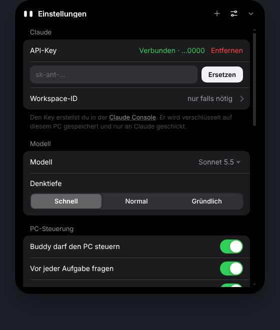

# Buddy Island

Ein kleiner Assistent, der wie die Dynamic Island oben in der Mitte deines Windows-Bildschirms wohnt. Buddy läuft mit deinem eigenen Claude-API-Key: Er beantwortet Fragen, stellt Timer, zeigt Musik, Termine und Windows-Mitteilungen, hört auf «Hey Buddy» und kann auf Wunsch den ganzen PC mit Maus und Tastatur bedienen.

> **Status:** Testversion (0.2). Getestet mit einer simulierten Claude-API unter Linux. Auf echten Windows-PCs bitte den Selbsttest in den Einstellungen laufen lassen.

<p align="center"></p>

| Chat | PC-Steuerung | Einstellungen |
| --- | --- | --- |
|  |  |  |

## Was Buddy kann

- **Chat mit Claude**: Antworten erscheinen live, mit Code-Blöcken und Kopieren-Knopf.
- **Timer**: «Stell einen Timer auf 10 Minuten». Der Countdown läuft im Island, am Ende wackelt Buddy und macht einen Ton.
- **Apps, Websites, Musik**: Rechner, Editor, Spotify öffnen; Musik pausieren, lauter oder leiser machen.
- **PC-Steuerung**: «Öffne den Editor und schreib eine Einkaufsliste». Buddy macht Bildschirmfotos und bedient Maus und Tastatur, bis die Aufgabe erledigt ist. Vorher fragt er um Erlaubnis.
- **Leuchtender Rand**: Solange Buddy nachdenkt, leuchtet der Bildschirmrand dezent weiss-grau, beim Steuern deutlich stärker. Wo Buddy klickt, erscheint eine kleine Welle.
- **Mitteilungen im Island**: Neue Windows-Mitteilungen (WhatsApp, Mail, Discord …) erscheinen kurz als Vorschau im Island.
- **Läuft gerade**: Musik aus Spotify, YouTube im Browser und anderen Apps erscheint im Island, mit Cover und Zurück / Pause / Weiter.
- **Kalender**: Über einen privaten iCal-Link (Google, Outlook, iCloud) zeigt Buddy die nächsten Termine und erinnert kurz vorher im Island. «Was steht heute an?» funktioniert auch.
- **Sprache**: Mikrofon-Knopf, eigenes Tastenkürzel oder «Hey Buddy». Buddy liest Antworten auf Wunsch vor.
- **Spielmodus**: Läuft ein Spiel oder eine Vollbild-App, versteckt sich Buddy komplett: keine Pop-ups, kein Ton, keine Steuerung. Verpasstes zeigt er danach.
- **Eigene Tastenkürzel und Kurzbefehle**: Jede Aktion bekommt ihr Kürzel, und feste Aufträge wie «Pausier die Musik» liegen auf einer Taste.
- **Mehrere Bildschirme**: Du wählst, auf welchem Bildschirm Buddy wohnt und arbeitet.
- **Selbsttest**: Ein Klick prüft API, Bildschirmfoto, Steuerung, Mitteilungen, Musik, Kalender, Sprache und Updates.


## Installation (einfach)

1. **Installer herunterladen**: Lade unter [Releases](../../releases) die Datei `BuddyIsland-Setup-….exe` herunter.
2. **Installieren**: Doppelklick auf die Datei. Falls Windows «Der Computer wurde durch Windows geschützt» anzeigt: «Weitere Informationen» → «Trotzdem ausführen». Das erscheint, weil die App (noch) nicht mit einem kostenpflichtigen Zertifikat signiert ist. Buddy installiert sich nur für deinen Benutzer, ohne Administratorrechte, und legt Verknüpfungen im Startmenü und auf dem Desktop an.
3. **API-Key verbinden**:
   - Öffne die [Claude Console](https://platform.claude.com/settings/keys), melde dich an und klicke auf «Create key».
   - Kopiere den Key (er beginnt mit `sk-ant-`).
   - Klicke oben auf das Island → «API-Key verbinden» → Key einfügen → «Verbinden».
4. **Fertig**: Mit <kbd>Strg</kbd> + <kbd>Umschalt</kbd> + <kbd>Leertaste</kbd> öffnest du Buddy von überall.
5. **Selbsttest**: Einstellungen → «Über Buddy» → «Selbsttest starten» zeigt dir, ob alles funktioniert.

**Updates** lädt Buddy automatisch im Hintergrund und installiert sie beim nächsten Beenden. Das funktioniert, sobald dieses Repository öffentlich ist und ein Release hat.

**Deinstallieren**: Windows-Einstellungen → Apps → Buddy Island → Deinstallieren.

### Optional: Kalender verbinden

- **Google Kalender**: calendar.google.com → Zahnrad → Einstellungen → links deinen Kalender wählen → ganz unten «Privatadresse im iCal-Format» kopieren.
- **Outlook**: outlook.com → Einstellungen → Kalender → Freigegebene Kalender → «Kalender veröffentlichen» → ICS-Link kopieren.
- In Buddy: Einstellungen → Kalender → Link einfügen → «Verbinden».

### Optional: Mitteilungen nur noch im Island

Damit unten rechts nichts mehr aufpoppt, schalte in Windows **«Nicht stören»** ein (Einstellungen → System → Benachrichtigungen). Die Mitteilungen landen trotzdem bei Buddy. In Buddys Einstellungen gibt es dafür einen Knopf, der dich direkt dorthin bringt. Falls der Status «Zugriff verweigert» zeigt, erlaube unter Einstellungen → Datenschutz → Benachrichtigungen den Zugriff für Desktop-Apps.

## Selbst bauen

Voraussetzung: [Node.js](https://nodejs.org) 20 oder neuer. Für den Installer unter Linux oder macOS zusätzlich [Wine](https://www.winehq.org).

```bash
git clone https://github.com/<dein-name>/buddy-island.git
cd buddy-island
npm install
npm start          # startet Buddy direkt aus dem Code
npm test           # Tests für die Claude-Anbindung und die Werkzeuge
npm run dist:win   # baut den Installer nach dist/
npm run pack:win   # nur die entpackte Windows-App (ohne Installer)
```

## Bedienung

| Was | Wie |
| --- | --- |
| Buddy öffnen / schliessen | <kbd>Strg</kbd> + <kbd>Umschalt</kbd> + <kbd>Leertaste</kbd> oder Klick aufs Island |
| PC-Steuerung stoppen | Gleiches Tastenkürzel oder der Stopp-Knopf im Island |
| Neuer Chat | <kbd>Strg</kbd> + <kbd>N</kbd> |
| Einstellungen | <kbd>Strg</kbd> + <kbd>,</kbd> |
| Schliessen | <kbd>Esc</kbd> |

Alles läuft über das Island selbst: Klick drauf, oben rechts sind «Neuer Chat», «Einstellungen» und «Schliessen». Dazu gibt es ein Symbol im Infobereich der Taskleiste (Rechtsklick: Öffnen, Einstellungen, Beenden).

### Eigene Tastenkürzel

In den Einstellungen unter **Tastenkürzel** legst du fest, welche Tasten Buddy öffnen, einen neuen Chat starten, die Einstellungen öffnen oder eine laufende Aufgabe stoppen. Die Kürzel funktionieren überall in Windows.

Unter **Eigene Kurzbefehle** verbindest du ein Kürzel mit einem festen Auftrag, zum Beispiel <kbd>Strg</kbd> + <kbd>Alt</kbd> + <kbd>T</kbd> → «Stell einen Timer auf 5 Minuten» oder <kbd>F9</kbd> → «Pausier die Musik». Buddy erledigt das im Hintergrund, auch wenn das Island geschlossen ist.

## Sicherheit und Datenschutz

Ausführlich in [PRIVACY.md](PRIVACY.md). Kurz:

- **Dein API-Key** wird mit der Windows-Verschlüsselung (DPAPI, über Electrons `safeStorage`) nur auf deinem PC gespeichert und ausschliesslich an `api.anthropic.com` geschickt. Er steht nie im Code oder in diesem Repository.
- **Keine Telemetrie**: Buddy schickt nichts an andere Server.
- **PC-Steuerung** fragt vor jeder Aufgabe um Erlaubnis (abschaltbar). Buddy ist angewiesen, keine Passwörter oder Zahlungsdaten einzugeben, nichts zu kaufen und vor dem Verschicken von Nachrichten nachzufragen. Bildschirmfotos gehen dabei an Claude. Lass Buddy deshalb nicht steuern, während sensible Dinge offen sind.
- **Mitteilungen** bleiben auf deinem PC. Claude sieht sie nur, wenn du Buddy fragst, was du verpasst hast.
- Das Island und der leuchtende Rand werden aus Buddys Bildschirmfotos ausgeblendet (ab Windows 10, Version 2004).

## Ressourcen

Im Leerlauf läuft keine einzige Endlos-Animation: Das Fenster ist dann nur so gross wie das Island, und der leuchtende Rand ist ganz geschlossen. Der Steuerungs-Helfer startet erst, wenn Buddy steuern darf, und beendet sich nach zwei Minuten ohne Aktion. CPU und GPU sind im Leerlauf praktisch bei 0 %. Der RAM-Grundbedarf liegt bei etwa 80–120 MB, weil Buddy auf Electron (Chromium) läuft.

## Wie es funktioniert

| Datei | Aufgabe |
| --- | --- |
| `src/main.js` | Fenster, Tastenkürzel, Ablauf der Aufgaben mit Claude |
| `src/claude.js` | Anbindung an die Claude Messages API (Streaming, Prompt-Caching) |
| `src/tools.js` | Timer, Apps, Websites, Medientasten, Mitteilungen lesen |
| `src/computer.js` | Bildschirmfotos und Maus/Tastatur über Windows `SendInput` (kleiner PowerShell-Helfer) |
| `src/notifications.js` | System-Helfer: Windows-Mitteilungen, «Läuft gerade» und Spielmodus |
| `src/calendar.js` | Liest iCal-Kalender inkl. Wiederholungen und Zeitzonen |
| `src/voice.js` | «Hey Buddy» und Diktat über die Windows-Spracherkennung |
| `src/renderer/` | Das Island selbst (HTML, CSS, JS) |
| `src/glow/` | Der leuchtende Bildschirmrand |

## Bekannte Grenzen

- Nur Windows 10/11.
- Der Installer ist nicht signiert, deshalb die SmartScreen-Warnung beim ersten Start.
- Spiele mit Anti-Cheat (z. B. Valorant) blockieren simulierte Eingaben, solange sie im Vordergrund laufen.
- «Hey Buddy» braucht eine installierte Windows-Spracherkennung (Einstellungen → Zeit und Sprache → Sprache).
- Fenster mit Administratorrechten (z. B. der Task-Manager) kann Windows für Buddy sperren.
- Die PC-Steuerung braucht ein aktuelles Claude-Modell (z. B. Claude Sonnet 5.5) und kostet mehr API-Guthaben als ein normaler Chat, weil Bildschirmfotos mitgeschickt werden.

## Lizenz

MIT, siehe [LICENSE](LICENSE). Gebaut von Wolf Widmer.
