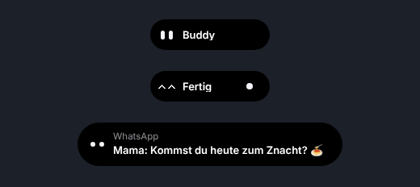

# Buddy Island

Ein kleiner Assistent, der wie die Dynamic Island oben in der Mitte deines Windows-Bildschirms wohnt. Buddy läuft über **Buddy Cloud**: Du meldest dich mit Google oder E-Mail an und bezahlst mit Buddy Credits. Er beantwortet Fragen, stellt Timer, zeigt Musik, Termine und Windows-Mitteilungen und hört auf «Hey Buddy».

**Website:** https://buddy-island.top · **Downloads:** https://github.com/wolfawidmer-sudo/buddy-island-releases/releases

> **Ab 0.13.1 nicht mehr Open Source.** Alle Rechte vorbehalten, siehe [LICENSE](LICENSE). Versionen bis und mit 0.13.0 bleiben unter MIT.

> **Ab 0.13:** Buddy läuft nur noch über Buddy Cloud. Eigene API-Keys und die lokale KI (Ollama, Colibrì, Hugging Face) gibt es nicht mehr; gespeicherte Keys werden beim Update gelöscht. Die PC-Steuerung mit Maus und Tastatur ist vorerst nicht verfügbar.

<p align="center"></p>

## Was Buddy kann

- **Ruhiges Island**: Geschlossen zeigt Buddy nur seine Augen, genau in der Mitte. Öffnen und Schliessen laufen ohne springende Texte.
- **Buddy Cloud**: Anmelden mit Google («Sign in with Google» nach Googles Richtlinien) oder E-Mail. Bezahlt wird mit Buddy Credits: eigener Betrag ab $5 oder Buddy Plus für $10 im Monat. Guthaben, Abo, Aufladen und Verlauf stehen in der Kontoansicht (Personen-Symbol oben im Island).
- **Einführung beim ersten Start**: Sprache, Anmelden, Tastenkürzel, Kontrolle, Beispiel-Frage. Überspringbar, unter Einstellungen › System › «Einführung zeigen» erneut startbar.
- **Einfache Einstellungen**: fünf Reiter (Allgemein, Funktionen, Sicherheit, Kürzel, System), immer nur einer sichtbar.
- **Notch-Modus**: Island anklicken, gedrückt halten und 1 Pixel nach oben ziehen: Es wird zu einem schwarzen Notch am Bildschirmrand. Nach unten oder ein Klick holt es zurück.
- **Gedächtnis**: «Merk dir, dass …» speichert kurze Notizen lokal, nur auf ausdrücklichen Wunsch, nie Passwörter, Karten- oder Kontonummern.
- **Automatische Modellwahl**: Buddy wählt pro Anfrage das günstigste passende Modell und die Denktiefe. Ist ein Modell überlastet, weicht er für diese Anfrage auf ein anderes aus und sagt es im Chat.
- **Agent mit Plan**: Mehrstufige Aufgaben plant Buddy in Schritten und meldet nichts als erledigt, was er nicht geprüft hat.
- **Dateien ordnen**: auflisten, Duplikate finden, Ordner anlegen, verschieben, in den Papierkorb legen. Nur in deinen Benutzerordnern.
- **Berechtigungen**: Niedriges Risiko läuft direkt, mittleres fragt einmal pro Aufgabe, hohes (Löschen, Admin, System) jedes Mal.
- **Timer, Apps, Websites, Musik**: «Stell einen Timer auf 10 Minuten», Rechner oder Spotify öffnen, Musik pausieren oder leiser machen.
- **Mitteilungen und «Läuft gerade»**: Windows-Mitteilungen erscheinen kurz im Island, Musik mit Cover und Zurück / Pause / Weiter.
- **Kalender**: über einen privaten iCal-Link (Google, Outlook, iCloud), mit Erinnerung vor Terminen.
- **Sprache**: Mikrofon-Knopf, eigenes Tastenkürzel oder «Hey Buddy» (standardmässig aus). Antworten auf Wunsch vorgelesen.
- **Spielmodus**: Läuft ein Spiel oder eine Vollbild-App, hält sich Buddy ganz zurück.
- **Eigene Tastenkürzel und Kurzbefehle**, mehrere Bildschirme, hell und dunkel, Deutsch, Englisch, Französisch.
- **Eigenes Design-System «Nachtinsel»**: alle Werte aus Design-Tokens (`src/renderer/css/tokens.css`).

## Installation

1. **Installer herunterladen**: unter [Releases](https://github.com/wolfawidmer-sudo/buddy-island-releases/releases) die Datei `BuddyIsland-Setup-….exe`.
2. **Installieren**: Doppelklick. Falls Windows «Der Computer wurde durch Windows geschützt» zeigt: «Weitere Informationen» → «Trotzdem ausführen». Das erscheint, weil der Installer nicht mit einem kostenpflichtigen Zertifikat signiert ist.
3. **Anmelden**: Die Einführung öffnet sich beim ersten Start. Mit Google oder E-Mail anmelden, Guthaben aufladen.
4. **Öffnen**: <kbd>Strg</kbd> + <kbd>Umschalt</kbd> + <kbd>Leertaste</kbd> oder Klick aufs Island.

**Updates** lädt Buddy automatisch und installiert sie nur, wenn die Ed25519-Signatur des Releases und die SHA-512-Prüfsumme stimmen und die Version neuer ist. Startet eine neue Version mehrmals nicht sauber, kehrt Buddy zur vorherigen signierten Version zurück.

## Selbst bauen

Voraussetzung: [Node.js](https://nodejs.org) 20 oder neuer.

```bash
npm install
npm start                  # Buddy direkt aus dem Code
npm test                   # Unit-Tests
npm run test:onboarding    # Einführung und Oberfläche im Browser (braucht Chrome)
npm run dist:win           # Installer nach dist/
```

Ohne Electron lässt sich die Oberfläche mit einer nachgebauten Brücke ansehen: `python3 test/ui/screens.py` macht Screenshots (Python-Playwright und Chrome nötig).

### Neue Version veröffentlichen

1. Einmalig: den privaten Signierschlüssel als Secret `BUDDY_UPDATE_SIGNING_KEY` in der GitHub-Umgebung **«release»** hinterlegen (Settings → Environments → release, mit Freigabe durch Wolf). Nicht als Repository-Secret. Der öffentliche Schlüssel steht in `src/update-security.js`.
2. `version` in `package.json` erhöhen und `whats-new.json` ergänzen.
3. Workflow «Release» von Hand starten. Er baut den Installer, signiert das Update und veröffentlicht das Release. Installierte Buddys aktualisieren sich danach selbst.

Zum Testen ohne Release: ein Commit mit `[testversion]` in der Nachricht auf `buddy-cloud` baut den Installer als Download (Artifact).

## Sicherheit und Datenschutz

Ausführlich in [PRIVACY.md](PRIVACY.md). Kurz:

- **Anmeldung**: Die Sitzung mit Buddy Cloud wird mit der Windows-Verschlüsselung (DPAPI) gespeichert. Die Oberfläche sieht nie Tokens.
- **Was an Buddy Cloud geht**: was du schreibst oder sagst. Buddy Cloud leitet es an OpenAI weiter. Bezahlt wird über Stripe.
- **Keine Telemetrie**, keine Werbung.
- **Chatverlauf, Gedächtnis, Mitteilungen, Kalender** bleiben auf deinem PC.

## Wie es funktioniert

| Datei | Aufgabe |
| --- | --- |
| `src/main.js` | Fenster, Tastenkürzel, Updates, Verbindung der Teile |
| `src/cloud-only.js` | Umstellung auf «nur Buddy Cloud» beim Start (alte Keys löschen, Hinweis für bestehende Nutzer) |
| `src/cloud/` | Konto, Anmeldung (Google-Loopback mit PKCE), Guthaben |
| `backend/` | Buddy-Cloud-Server: Konten, Buddy Credits, OpenAI-Gateway, Stripe |
| `src/llm/` | Anbieter-Schnittstelle und Adapter, Fehlerklassen, Ausweichmodelle |
| `src/models.js`, `src/router.js` | Modelle, Preise, Modellwahl |
| `src/agent.js`, `src/permissions.js` | Ausführung, Plan, Freigaben |
| `src/tools.js`, `src/files.js` | Timer, Apps, Medien, Dateien |
| `src/notifications.js`, `src/calendar.js`, `src/voice.js` | Mitteilungen, Kalender, Sprache |
| `src/update-security.js` | Signatur- und Kompatibilitätsprüfung für Updates |
| `src/i18n/` | Deutsch (Quelle), Englisch, Französisch |
| `src/renderer/` | Das Island (HTML, CSS, JS); Google-«G» in `img/google-g.svg` |

Der Code für lokale KI und eigene Keys (`src/local/`, Adapter in `src/llm/`) liegt noch im Repo und ist getestet, wird aber nicht mehr gestartet.

## Bekannte Grenzen

- Nur Windows 10/11, Installer nicht code-signiert (SmartScreen-Warnung).
- PC-Steuerung mit Maus und Tastatur ist mit Buddy Cloud noch nicht verfügbar.
- Spracherkennung läuft über Windows, nicht über Buddy Cloud.
- «Hey Buddy» braucht eine installierte Windows-Spracherkennung.

## Lizenz

Alle Rechte vorbehalten, siehe [LICENSE](LICENSE). Versionen bis und mit 0.13.0 unter MIT. Gebaut von Wolf Widmer.
